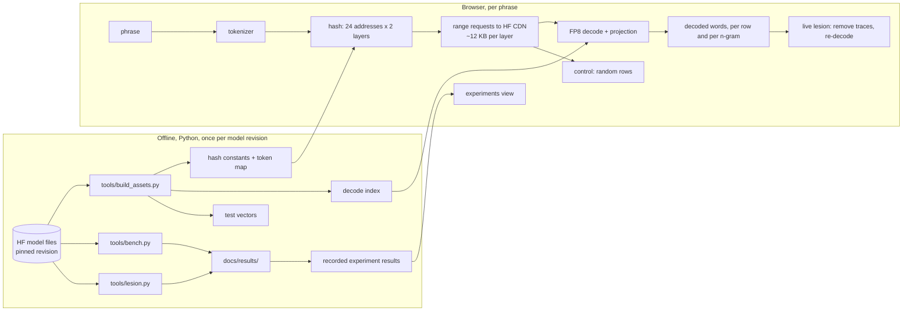

# Design Document: Engramscope

## Overview

Engramscope reruns Lashley's lesion experiments and Semon's partial-cue test on DeepSeek-V4.1-Flash's Engram memory (Req 9). It is a static web app plus a small Python toolkit.

- **Python toolkit (`tools/`)** runs the science: the readout benchmark (Req 6) and the lesion experiments (Req 9), both with the exact readout. It also builds everything the browser needs from the pinned model files (hash constants, the compressed token map, the decode index, test vectors, and the recorded experiment results). It is the reference implementation.
- **Web app (`web/`)** tokenizes the phrase, computes addresses, fetches rows from the Hugging Face CDN with range requests, projects and decodes them with the decode index, and shows the result. No Engramscope server.

## Model facts (pinned)

All values below were read from the model files on 2026-11-19 (kill test).

| Item | Value | Source |
| --- | --- | --- |
| Repository | `deepseek-ai/DeepSeek-V4.1-Flash`, revision `314113f8a7dadb388215396ba5fbee2c610a04d6`, MIT | HF API |
| Engram layers | 1 and 14 | `config.json` `engram_layer_ids` |
| Rows per table | 384,006,168 (layer 1), 384,016,682 (layer 14) | config; equals the sum of the bucket primes |
| Row format | 256 × FP8 E4M3, plus 8 × E8M0 scales (one per 32 values), in separate tensors | safetensors headers |
| N-gram sizes, heads | 2, 3, 4 × 8 heads = 24 rows per position per layer | config |
| Compressed vocab | 99,092 | config; reproduced from `tokenizer.json` |
| Pad token | id 2 | config |
| Hash | rolling XOR of `compressed_id × multiplier` over up to 4 tokens, then `mod prime + offset` per (n-gram size, head); multipliers from `numpy.random.default_rng(10007 × layer_id)` | `inference/engram.py` |
| Value projection | `wkv.weight` [25,600 × 6,144] FP8 with 32×32 E8M0 block scales; the last 5,120 output rows are the value, the first 4 × 5,120 are keys (one per hyper-connection copy) | safetensors; `inference/model.py` `Engram` |
| Files | layer 1: shard 47 of 48; layer 14: shard 48; output head and final norm: shard 43; input embeddings: shard 2 | `model.safetensors.index.json` |
| Browser access | CDN answers range requests with `access-control-allow-origin: *` and allows the `Range` header | curl preflight, 2026-11-19 |
| Hub rate limit | 3,000 resolver requests per 300 s; the redirect to the CDN counts, the CDN fetches do not | response headers |

## Components

### 1. Reference implementation (`tools/engramscope/`)

- `hashing.py`: token map, primes, offsets, multipliers, `addresses(token_ids, layer)`. Ported from the kill-test spike, with the checks from Req 1.2 run on import of the constants file.
- `fetch.py`: safetensors header parsing, byte offsets for row `r` (`data_start + data_offsets[0] + r × 256` and `scales_start + r × 8`), CDN resolution once per file, range fetch with 429 back-off.
- `fp8.py`: E4M3 and E8M0 decode tables. Tests compare against `ml_dtypes` or `torch` where available.
- `readout.py`: value vector `Wv @ concat(rows)`, per-row contributions `Wv[:, block_c] @ row_c`, cosine decoding against embeddings.
- `build_assets.py`: writes `web/public/assets/<revision>/` (constants JSON, token map, decode index, test vectors).
- `bench.py`: Requirement 6.
- `lesion.py`: Requirement 9, following `bench/lesion-protocol.md` exactly (Section 8 below).

### 2. Decode index (Gate G1 decides the format)

The exact readout needs the input embedding table (129,280 × 5,120 BF16, 1.32 GB) and each layer's value projection (5,120 × 6,144 FP8, 31.5 MB). Too large for a browser. Proposed format:

- **Reduce the embedding space with PCA to d dimensions** (start with d = 256), fitted on the embedding table. Store `E' = normalize(Eᵀ projected)` as int8 with a per-row scale: 129,280 × 256 bytes ≈ **33 MB**.
- **Fold the projection into the value matrix:** `M_layer = P × Wv` (d × 6,144) in float16, about **3 MB per layer**. A value vector in the reduced space is then `M_layer @ x` with `x` the 6,144 fetched values. Per-row contributions are `M_layer[:, block_c] @ row_c`.
- Decoding is a 129,280 × 256 int8 dot product per readout (33M multiply-adds), fast in WebAssembly or plain JS with typed arrays.

**Chosen after G1 (Decision 8):** the readout-fitted projection, d = 1,024, 4-bit (G1: top-10 overlap 0.60 with the exact readout on layer 1, about 92 MB with both layers). Shipping plan:
- Store the embedding side as 4 chunks of 256 dimensions, each with its own per-token fp16 scale. The fitted directions are ordered by importance, so the first chunk alone is the d = 256 index. The browser decodes as soon as chunk 1 arrives (about 17 MB) and sharpens the words as the rest load. This also suits the visual direction (traces that sharpen).
- Cache the chunks in the browser (Cache Storage), so the download happens once per browser.
- Build the assets in CI from the pinned revision and deploy them with the Pages artifact, so no large binaries go into git. Task 4.2 measures the shipped format (per-chunk scales, each loading stage) against the exact readout, as Req 5.3 requires.
- First load is about 92 MB: roughly 15 s at 50 Mbps (**estimate**).

Gate G1 measured top-10 overlap between this readout and the exact one on a fixed phrase set, and the benchmark score with both. If overlap is too low, try in order: larger d (512, 64 MB); restrict the vocabulary to tokens that decode to whole words; or a fallback that ships the exact matrices with lazy, chunked loading. The size budget is confirmed by the builder at the Task 1 checkpoint.

### 3. Tokenizer in the browser (Gate G2)

The phrase must be tokenized exactly as the model does. Options in order:
1. `@huggingface/transformers` (transformers.js) `AutoTokenizer` loading the model's `tokenizer.json` (6.4 MB) from the pinned revision.
2. The `tokenizers` Rust crate compiled to WebAssembly.

Gate G2 checks token ids against the Python `tokenizers` output on 1,000 strings, including CJK, Indonesian, emoji and leading spaces. Exactness is required (Req 1).

### 4. Hash in the browser

`BigInt` arithmetic for the 64-bit products and XOR. Multipliers stay below `INT64_MAX / 99,092 / 2`, so every product is below 2⁶³, and the reference uses signed int64 with non-negative values throughout, so unsigned BigInt arithmetic gives the same bits. Primes and offsets are loaded from the constants JSON. Test vectors generated by the Python reference are checked in `vitest` (Req 1.3).

### 5. Fetcher in the browser

- Resolve each shard's CDN URL once (one hub request per shard, two shards per session), then issue range requests directly.
- One row is two requests (values and scales, which are separate tensors). 24 rows × 2 tensors × 2 layers = 96 requests per lookup, run with a concurrency limit (start at 16). Measured in the kill test: about 0.2 s per request from the sandbox. Gate G3 measures end-to-end time in a real browser on the builder's connection.
- Cache fetched rows in memory for the session (and optionally IndexedDB).
- Control readout: 24 random rows per layer, fetched the same way.

### 6. Web app (`web/`)

React + Vite + TypeScript, built to a static site on GitHub Pages.

Views:
- **Landing:** Lashley's question in one line ("Where is a memory stored?"), one input, example phrases, and the way into the experiments.
- **Experiments:** the recorded results of Req 9, one panel per question, each naming its source and page. Mass-action curve with intervals and references; equipotentiality comparison (structured against random lesions); partial-cue results. Read from `docs/results/lesion-*.json`.
- **Live lesion:** a phrase's 24 traces as a 3 × 8 grid (n-gram size × head). The viewer switches traces off and on, or uses presets matching the protocol's conditions. The decoded words and the vector similarity to the intact memory update at once, because the value vector is a sum: no new fetch, one decode per change. Labelled as exploration.
- **Read:** decoded words for layer 1 (and 14, labelled), the control beside them, bytes fetched ("12 KB of 189 GiB"), time taken. Inside it, the pipeline from Req 3, with each of the 24 rows as a card: n-gram window, head, address, byte offset, top words for that row alone.
- **About:** history (from `docs/theory-sources.md`), what is DeepSeek's, Lashley's and Semon's, and Engramscope's, the benchmark table with intervals, limitations, sources.

Visual direction (Req 7.3): dark, archival, "memory traces". Rows appear as faint traces that sharpen as their bytes arrive. The decoded words fade in by similarity. Data stays legible: no effect hides a number.

### 7. Benchmark (`tools/bench.py`, Req 6)

- Phrase set in `bench/phrases.jsonl`: phrase, related-word set, category, author note. Committed **before** any readout of those phrases; `bench.py` refuses to run on a phrase file whose commit is newer than the latest readout log, as a guard.
- Controls: random rows (fixed seed), last-token input embedding, shuffled phrase (rows of another phrase from the set), layer 14.
- Matching: decoded tokens are stripped and lowercased; a hit is any match with the set, after excluding the phrase's own words and their normalized forms.
- Output: `docs/results/bench-<date>.json` with per-phrase decoded lists, and a Markdown table with hit@k and 95% bootstrap intervals (2,000 resamples).
- The 30-phrase pilot from the kill test is kept as a pilot and not counted.

### 8. Lesion experiments (`tools/lesion.py`, Req 9)

- **Protocol:** `bench/lesion-protocol.md` defines conditions, measures, seeds, references and the interpretation rules. `lesion.py` encodes those conditions, and a unit test checks them against the protocol's table. The script records the protocol's git hash and refuses to run if the file has uncommitted changes or differs from its approval commit.
- **Computation:** for each phrase and layer, fetch the 24 rows once, compute the 24 contributions `cᵢ` (5,120-dim each), and evaluate every condition as a sum of a subset of them. That is a few thousand decodes per phrase. Batching all decodes per phrase into one matrix product against the embedding table (129,280 × 5,120) keeps a full run within minutes on the sandbox CPU (**estimate**; measured on the first run).
- **Context condition (C2):** the phrase is re-tokenized after each prefix. Rows whose address is unchanged are counted and reused.
- **Output:** JSON with per-condition decoded lists and measures, and a Markdown report that applies the approved rules mechanically and prints the outcome of each.
- **Browser:** reads the recorded results only. The live lesion view uses the compressed decode index, and its numbers are labelled as approximate (Req 4.4).

## Correctness properties

For property-based tests (`hypothesis` in Python; shared test vectors for the web). Properties 1–8 and 10 are Python; 9 is web.

1. **Hash parity:** for any token sequence, the reference `addresses()` equals a direct transcription of `inference/engram.py` run with numpy int64 arithmetic.
2. **Address range:** every address for column c lies in `[offset_c, offset_c + prime_c)`, and the ranges of different columns do not overlap.
3. **Bucket sum:** the primes of each layer sum to the layer's row count.
4. **Normalization invariance:** phrases that differ only in case, accents or repeated whitespace give the same addresses whenever they tokenize to the same compressed ids.
5. **Padding:** for position t < 3, the missing history is the pad id, and the 2-gram address of position 0 depends only on token 0.
6. **Byte offsets:** row r's value bytes start at `data_start + data_offsets[0] + 256r` and lie inside the tensor's byte range.
7. **FP8 round trip:** decoding all 256 E4M3 codes matches a reference library; E8M0 code 255 is NaN and never appears in fetched scales.
8. **Linearity:** the sum of the 24 per-row contributions equals the full value vector (within float tolerance).
9. **Web parity:** the browser hash and readout match the Python test vectors exactly (addresses) or within tolerance (vectors).
10. **Lesion additivity:** for any subset S, decoding `v_S` from the stored contributions equals decoding `Wv · concat(rows with S zeroed)`; the empty lesion equals the intact readout, and removing all 24 rows gives the zero vector (reported as "nothing left", not decoded).

## Testing strategy

- Python: `pytest` + `hypothesis` for properties 1–8 and 10; network tests marked and skipped unless `ENGRAMSCOPE_TEST_NETWORK=1`.
- Web: `vitest` for hash, FP8, offsets and readout against test vectors; Playwright smoke test of the built site against a recorded fixture (no live CDN in CI).
- CI: GitHub Actions for Python and web lint and tests.

## Error handling

- CDN or hub failure: show which request failed and retry with back-off; never show partial decoded words as complete.
- Rate limit (HTTP 429): honour `Retry-After`; show a "the model's memory is busy" state.
- Unknown or empty phrase: the hash still works (padding); show that even "nothing" has an address.
- Model revision unavailable: the app shows the pinned revision and stops; it never silently uses `main`.

## Risks

| Risk | Effect | Mitigation |
| --- | --- | --- |
| Compressed decode index loses too much (G1) | Wrong words in the browser | Larger d, restricted vocab, or lazy exact matrices |
| Browser tokenizer differs from Python (G2) | Wrong addresses | WebAssembly build of `tokenizers` |
| Latency too high on home connections (G3) | Sluggish demo | Concurrency tuning, session cache, prefetch while typing |
| Benchmark result weaker than the pilot (G4) | Weaker claim | Report it honestly (Req 6.5); the mechanism view still stands |
| Hub rate limits | Errors for heavy users | Resolve once per shard; back-off |
| Trademark rule in the video | Disqualification risk | Video names the model generically (`?generic` flag); no logos |
| Prior art appears | Novelty claim narrows | Re-check before submission (Task 1.6, Task 9) |
| Lesion results are trivial (e.g. every curve follows the orthogonal reference) | Weaker story | Report it: that itself answers Lashley's question for this memory (traces are independent and equal). The protocol's references make "trivial" visible instead of hidden |
| Trace lesions read as claims about the model's behaviour | Overclaim | Label every result "trace lesion (readout)"; behavioural lesion only via Req 10 |
